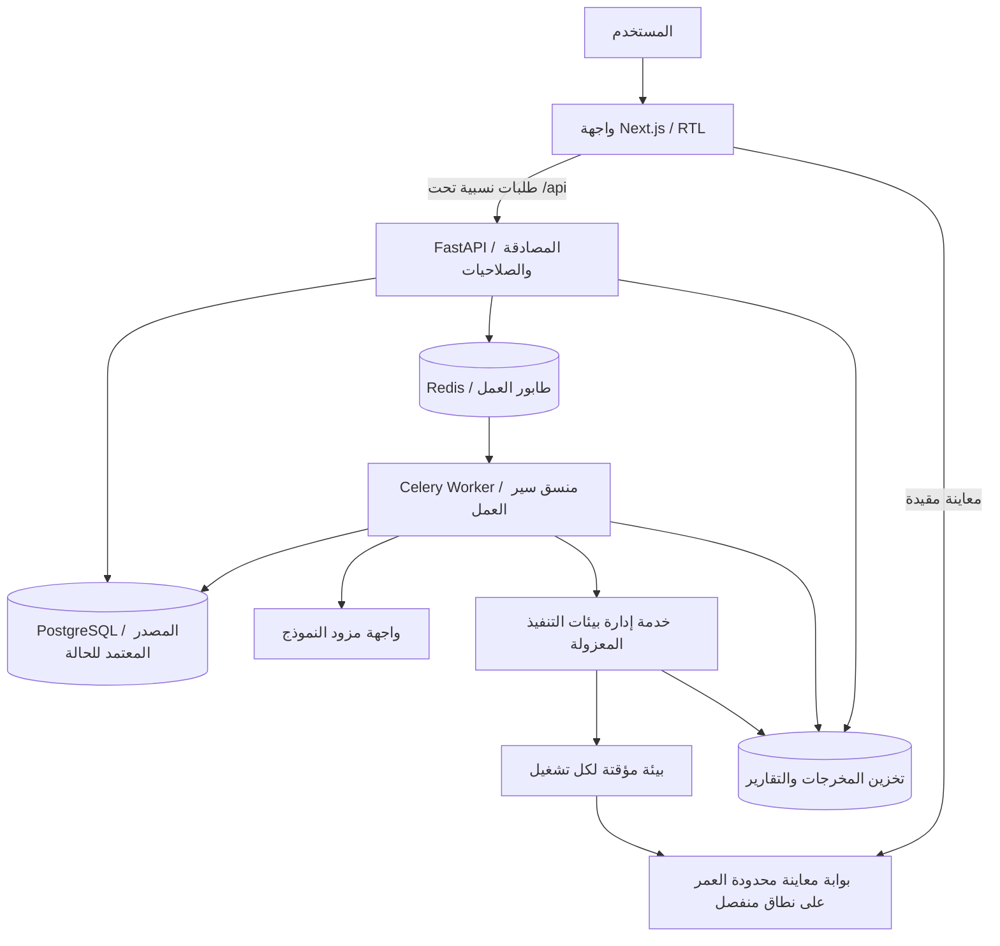

# SOFTWARE FACTORY — خطة المنتج والمعمارية

> الحالة: المعمارية المستهدفة، وليست وصفًا لكل ما نُفّذ. بدأت النسخة التأسيسية؛ راجع [حالة التنفيذ الفعلية](IMPLEMENTATION.ar.md).
> تاريخ الإعداد: 14 أكتوبر 2026.
> القرار المؤكد: بناء مصنع برمجيات بالذكاء الاصطناعي، والبدء بالخطة والمعمارية.

## 1. الهدف

منصة تحول فكرة تطبيق إلى مشروع برمجي قابل للمراجعة والتشغيل، عبر سير عمل واضح يجمع بين وكلاء ذكاء اصطناعي، أدوات تنفيذ واختبار، وموافقات بشرية.

**المسار المستهدف:** فكرة ← متطلبات ← اعتماد المستخدم ← خطة تنفيذ ← توليد الكود ← اختبارات وإصلاحات محدودة ← معاينة ← اعتماد وتسليم.

المنصة ليست روبوت محادثة فقط: كل تشغيل ينتج ملفات وأدلة اختبار وسجل قرارات وتكلفة يمكن تتبعها. لا تعني كلمة «مصنع» ضمان أن كل فكرة ستتحول تلقائيًا إلى تطبيق صالح للإنتاج.

## 2. افتراضات تحتاج إلى اعتماد

- المستخدم الأول: مطور مستقل أو فريق صغير، وليس مؤسسة متعددة الأقسام.
- الواجهة عربية باتجاه RTL، مع إبقاء أسماء الملفات والكود بالإنجليزية.
- البداية بتطبيقات ويب صغيرة من قالب واحد محدد، لا بكل أنواع البرمجيات.
- اقتراح القالب الأول: Next.js + TypeScript + Tailwind CSS، مع بيانات محلية تجريبية؛ التطبيقات ذات الخلفية وقاعدة البيانات المولّدة تأتي لاحقًا.
- يستخدم المصنع مزود نماذج واحدًا في البداية، وراء واجهة تسمح باستبداله لاحقًا. لم يُختَر المزود بعد.
- مفاتيح النماذج في خادم المصنع فقط؛ لا تُرسل إلى المتصفح أو بيئة تشغيل الكود المولّد.
- بيئة الاستضافة والميزانية وسياسة الاحتفاظ بالبيانات لم تُحدَّد بعد.

هذا التضييق مقصود: نثبت أولًا إمكانية إنتاج مشروع صغير قابل للبناء والاختبار، قبل توسيع التوليد إلى تطبيقات كاملة ذات بيانات حساسة.

## 3. نطاق النسخة الأولية MVP

### داخل النطاق

1. تسجيل دخول، ومساحة عمل بسيطة تعزل مشاريع المستخدم عن غيره.
2. إنشاء مشروع من وصف حر، مع أسئلة توضيحية عند الحاجة.
3. إخراج وثيقة متطلبات ومعايير قبول يمكن تعديلها واعتماد نسخة منها.
4. إخراج خطة مهام وهيكل ملفات ضمن القالب المدعوم.
5. تشغيل مراحل التوليد بالتتابع، مع سجل أحداث حي وإمكانية الإلغاء.
6. بناء الكود وتشغيل الفحوص داخل بيئة تنفيذ معزولة ومحدودة الموارد.
7. دورة إصلاح محدودة، ثم إظهار نتيجة صادقة: ناجح، فاشل، أو يحتاج تدخلًا.
8. عرض الملفات والتغييرات وتقارير الاختبار، ومعاينة مؤقتة بعد اجتياز فحوص الأمان.
9. تنزيل نسخة ZIP من الملفات المعتمدة مع README وتعليمات التشغيل وملفات تثبيت الإصدارات.
10. عرض استهلاك الرموز والتكلفة التقديرية لكل تشغيل عند توفر تسعير المزود.

### خارج النطاق في البداية

- النشر التلقائي إلى الإنتاج أو إدارة بيانات العملاء الحقيقية.
- تعديل مستودعات خارجية أو دمج Pull Requests دون موافقة صريحة.
- تطبيقات الهاتف وسطح المكتب، والخدمات الخلفية المعقدة أو المدفوعات المولّدة.
- عمل وكلاء غير محدود أو بحث مفتوح على الإنترنت أثناء التوليد.
- متجر قوالب، فوترة اشتراكات، وتعاون آني متعدد المستخدمين.
- تدريب نموذج خاص من الصفر.

## 4. تجربة المستخدم

| الشاشة | الغرض |
|---|---|
| لوحة المشاريع | إنشاء مشروع ومتابعة حالته وآخر تشغيل |
| وصف المشروع | إدخال الفكرة والقيود والإجابة عن الاستيضاحات |
| المتطلبات والخطة | تعديل النطاق ومعايير القبول واعتماد النسخة |
| مساحة التشغيل | متابعة المراحل والأحداث والاستهلاك وإلغاء التنفيذ |
| مراجعة النتائج | تصفح الملفات والفروق وتقارير الاختبار والمعاينة |
| التسليم والإعدادات | تنزيل المخرجات وضبط حدود التشغيل والاحتفاظ |

يجب التمييز في الواجهة بين «تم توليد الكود» و«اجتاز الفحوص» و«اعتمده المستخدم». نجاح أمر البناء لا يثبت صحة جميع المتطلبات أو سلامة التطبيق للإنتاج.

## 5. المعمارية المقترحة



### اختيارات التقنية وأسبابها

| الجزء | الاختيار المقترح | السبب |
|---|---|---|
| واجهة المصنع | Next.js + TypeScript + Tailwind CSS | واجهة تفاعلية مع دعم RTL وأنواع ثابتة |
| API | Python + FastAPI + Pydantic | عقود واضحة والتحقق من مدخلات ومخرجات الوكلاء |
| تنسيق المهام | Celery + Redis | تشغيل خارج دورة طلب HTTP وإعادة المحاولة والإلغاء التعاوني |
| البيانات | PostgreSQL + SQLAlchemy + Alembic | معاملات، سجل دائم، وترحيلات منظمة |
| أحداث الواجهة | Server-Sent Events | متابعة أحادية الاتجاه دون تعقيد WebSocket في البداية |
| المخرجات | واجهة تخزين S3-compatible؛ مجلد محلي للتطوير | فصل الملفات الكبيرة عن قاعدة البيانات وعن Git |
| تنفيذ الكود | Runner منفصل؛ حاويات مقيدة للتطوير فقط | عزل التنفيذ عن API وعن أسرار المصنع |
| اختبار المصنع | pytest + Vitest + Playwright | تغطية الخلفية والواجهة والمسار الكامل |
| التطوير المحلي | Docker Compose | تشغيل مكونات المصنع بشكل متكرر وقابل للتوثيق |

ابدأ بتطبيق خلفي واحد منظم إلى وحدات، وعامل مهام من نفس الشيفرة، وخدمة تنفيذ منفصلة لأسباب أمنية. لا نحتاج شبكة microservices أو إطار multi-agent معقدًا في النسخة الأولى.

طلبات المتصفح إلى API تكون نسبية، وتُمرَّر عبر reverse proxy؛ لا يعتمد المتصفح على `localhost` للوصول إلى خدمات الخادم. عند التطوير السحابي يجب تقييد السماح بالنطاقات إلى نطاق المعاينة الفعلي، لا فتح جميع الأصول مع ملفات تعريف الارتباط.

## 6. أدوار الوكلاء

الأدوار خطوات ذات مدخلات ومخرجات منظمة، وليست كيانات حرة الصلاحيات. يمكن للنموذج نفسه تنفيذ جميع الأدوار في البداية.

| الدور | المدخلات | المخرجات | القيود |
|---|---|---|---|
| محلل المتطلبات | وصف المستخدم وإجاباته | متطلبات وأسئلة ومعايير قبول | لا ينفذ أدوات نظام |
| مخطط الحل | نسخة متطلبات معتمدة وقالب معروف | خطة مهام وبنية ملفات | لا يوسع النطاق بصمت |
| مطور الكود | مهمة محددة وملفات مسموحة | تعديلات ملفات منظمة | لا يصل إلى أسرار المصنع أو يختار أوامر shell حرة |
| مراجع الاختبارات | المتطلبات والتغييرات ونتائج التنفيذ | ملاحظات واختبارات إضافية | لا يقرر النجاح دون أدلة من Runner |
| مصلح الأخطاء | سجل فشل منقح والملفات المرتبطة | تعديل محدود مرتبط بالخطأ | لا يحذف الاختبارات لتجاوز الفشل |

**المنسق البرمجي** هو صاحب القرار في الانتقال بين الخطوات، واحتساب الميزانية، والموافقات، وتنفيذ الأدوات. لا يُترك ذلك لنص يولده النموذج.

## 7. حالات التشغيل وضبط الاستمرارية

حالات التشغيل المقترحة:

`queued → analyzing → awaiting_approval → planning → generating → validating → awaiting_review → completed`

- يمكن لـ `validating` الانتقال إلى `repairing` ثم الرجوع للفحص ضمن حد الإصلاحات.
- حالات النهاية الأخرى: `failed` و`cancelled` و`budget_exceeded`.
- `awaiting_approval` و`awaiting_review` حالتان محفوظتان في قاعدة البيانات؛ لا يبقى عامل التنفيذ محجوزًا أثناء انتظار المستخدم.
- تعديل المتطلبات بعد اعتمادها ينشئ نسخة جديدة ويلغي صلاحية الاعتماد القديم للمحاولات التالية.
- كل تشغيل يرتبط بنسخة متطلبات وقالب وتعليمات ومخرجات محددة لتسهيل التتبع.
- تُكتب طلبات إرسال العمل في transactional outbox مع تحديث الحالة، ويعيد ناشر إرسالها إلى الطابور عند التعطل.
- الطابور قد يسلّم المهمة أكثر من مرة؛ تُستخدم مفاتيح idempotency وقفل/lease على الخطوة لمنع إنشاء مخرجات مكررة.
- ينفذ العامل heartbeat، ويكشف مراقب التشغيل المهام العالقة. تُعاد المحاولة فقط عندما يمكن إثبات أمان تكرار الأثر؛ لا نفترض تنفيذًا «مرة واحدة بالضبط».
- طلب الإلغاء يوقف جدولة الخطوات ويطلب إنهاء Runner؛ لا يوصف التشغيل بأنه ملغى قبل تأكيد وقف العمليات أو عزلها وانتهاء صلاحيتها.

### حدود ابتدائية مقترحة قابلة للضبط

- تشغيل نشط واحد لكل مشروع.
- محاولتا إصلاح كحد أقصى بعد الفحص الأول.
- مهلة افتراضية 10 دقائق لمرحلة التنفيذ، تُراجع بعد قياس القالب.
- سقف رموز وتكلفة لكل تشغيل، يُحجز جزء منه قبل كل طلب نموذج ويُسوّى بعده.
- إذا لم يتوفر تسعير موثوق للمزود، تُعرض التكلفة كغير متاحة ويُفرض سقف الرموز وعدد الطلبات، لا رقم تكلفة مضلل.

## 8. نموذج البيانات الأساسي

كل سجل يخص مستخدمًا أو مساحة عمل يجب أن يخضع لفحص الملكية في الخادم، بما في ذلك الأحداث وتنزيل الملفات والمعاينات.

| الكيان | البيانات المهمة |
|---|---|
| User / Workspace / Membership | الهوية، مساحة العمل، الدور |
| Project | المساحة، الاسم، الوصف، القالب |
| RequirementRevision | المشروع، رقم النسخة، المتطلبات، معايير القبول |
| Approval | النسخة أو مجموعة المخرجات المعتمدة، المعتمد، وقت الاعتماد |
| Run | المشروع، نسخة المتطلبات، الحالة، الحدود، استهلاك الرموز والتكلفة |
| Step | التشغيل، الدور، الحالة، رقم المحاولة، مفتاح التكرار، lease وheartbeat |
| RunEvent | التشغيل، رقم تسلسلي، النوع، بيانات منقحة، الوقت |
| Artifact | التشغيل، مفتاح التخزين، النوع، الحجم، بصمة المحتوى |
| TestReport | التشغيل، أمر الفحص المعتمد، رمز الخروج، ملخص وتفاصيل النتائج |
| Preview | التشغيل، مرجع البيئة، انتهاء الصلاحية، حالة الإيقاف |
| OutboxEvent | نوع العمل، مرجع السجل، حالة الإرسال والمحاولات |
| AuditEntry | الفاعل، العملية الحساسة، الهدف، الوقت |

لا يُخزّن محتوى الأسرار في سجلات الوكلاء. لا تُعرض سلسلة التفكير الداخلية؛ تعرض الواجهة قرارات مختصرة وأدلة ونتائج الأدوات فقط.

## 9. واجهات API الأولية

المسار الأساسي: `/api/v1`. جميع المسارات محمية بالمصادقة والملكية ما عدا فحص صحة محدود لا يعرض بيانات حساسة.

| الطريقة والمسار | الغرض |
|---|---|
| `POST /projects` | إنشاء مشروع |
| `GET /projects` | عرض مشاريع المستخدم |
| `GET /projects/{id}` | تفاصيل المشروع |
| `POST /projects/{id}/runs` | بدء تشغيل مع مفتاح idempotency وحدود واضحة |
| `GET /runs/{id}` | الحالة والاستهلاك والنتائج |
| `GET /runs/{id}/events` | أحداث SSE مع الاستئناف باستخدام `Last-Event-ID` |
| `POST /projects/{id}/requirements` | حفظ نسخة متطلبات جديدة |
| `POST /runs/{id}/approve-requirements` | اعتماد نسخة بعينها ومتابعة التشغيل |
| `POST /runs/{id}/cancel` | طلب إيقاف التنفيذ |
| `GET /runs/{id}/artifacts` | فهرس الملفات والتقارير |
| `GET /artifacts/{id}/download` | تنزيل بعد فحص الصلاحية، أو رابط قصير العمر |
| `POST /runs/{id}/preview` | طلب معاينة معزولة بعد تحقق السياسات |
| `POST /runs/{id}/approve-delivery` | اعتماد مجموعة مخرجات محددة دون نشر |

تُرفض الانتقالات غير الصالحة برمز `409`. الاستدعاءات الطويلة ترجع `202` ومعرف التشغيل بدل إبقاء الطلب مفتوحًا. عند استخدام جلسات بملفات تعريف الارتباط، تُحمى طلبات التعديل من CSRF.

## 10. الأمان وحدود الثقة

**كل كود مولّد، وملف مشروع، وتعليمات مستوردة تعتبر مدخلات غير موثوقة.** محتوى المشروع لا يملك صلاحية تغيير سياسات المصنع حتى لو احتوى تعليمات موجهة للوكلاء.

- فصل API وعامل النماذج عن آلة تنفيذ الكود. لا يُركَّب Docker socket أو مجلد المضيف الحساس داخل بيئة المشروع.
- تشغيل بدون root، وإسقاط القدرات، ونظام ملفات أساسي للقراءة فقط، وحدود CPU والذاكرة والعمليات والقرص والوقت.
- منع الخروج الشبكي افتراضيًا، بما يشمل خدمات metadata والعناوين الداخلية؛ تنزيل التبعيات يتم في مرحلة منفصلة بسياسة allowlist وذاكرة تخزين معتمدة.
- تعطيل lifecycle scripts عند تثبيت الحزم افتراضيًا. أي استثناء يجب أن يكون لقالب/حزمة معتمدة، لا بناء على طلب النموذج وحده.
- أوامر البناء والاختبار تأتي من وصفة موثوقة للقالب. حقول `scripts` في مشروع مولّد ليست مصدر ثقة، وكل عمليات التنفيذ تبقى داخل العزل.
- التحقق من مسارات الملفات والروابط الرمزية وحدود الحجم لمنع الكتابة خارج مساحة التشغيل وملفات ZIP الخبيثة.
- فحص المخرجات بحثًا عن أسرار وتبعيات عالية الخطورة، مع توضيح أن هذه الفحوص لا تثبت الأمان الكامل.
- المعاينة على نطاق أصل منفصل عن المصنع، دون ملفات جلساته أو أسراره، مع وصول مؤقت وقيود iframe وCSP مناسبة. لا يكفي فصل المنفذ فقط.
- لا اتصالات إنتاج أو مفاتيح نشر في بيئة المخرجات. أي تكامل مستودع لاحقًا يحتاج صلاحيات محدودة وموافقة واضحة.
- تنقيح السجلات، وتشفير الاتصالات والتخزين بحسب الاستضافة، وإتاحة حذف المشروع ومخرجاته وفق سياسة احتفاظ معلنة.
- يجب توضيح ما يُرسل إلى مزود النموذج والتحقق من شروط الاحتفاظ والتدريب والمنطقة قبل إدخال بيانات خاصة.

**بوابة إطلاق إلزامية:** الحاويات وحدها على جهاز المصنع ليست حدًا أمنيًا كافيًا لخدمة عامة تنفذ كودًا غير موثوق. قبل الإتاحة العامة، نحتاج عزلًا أقوى مثل microVM أو خدمة sandbox مناسبة، ومراجعة أمنية واختبارات هروب وتسرب. يمكن تجربة المسار محليًا فقط ضمن بيئة تطوير مخصصة خالية من الأسرار.

## 11. هيكل المستودع المستهدف

هذا هيكل مخطط؛ لن تُنشأ خدمات فارغة على أنها منتج مكتمل.

```text
SOFTWARE-FACTORY/
├── apps/
│   └── web/                 # واجهة المصنع
├── services/
│   ├── api/                 # API ووحدات العمل وعامل Celery
│   └── runner/              # إدارة التنفيذ المعزول
├── packages/
│   ├── contracts/           # أنواع عميل مولدة من OpenAPI
│   └── templates/           # القالب الأول ووصفات الفحص الموثوقة
├── prompts/                 # تعليمات الأدوار المرقمة بالإصدارات
├── infra/                   # تشغيل محلي وسياسات العزل
├── tests/
│   └── e2e/                 # اختبارات المسار الكامل
└── docs/
    └── PRODUCT-ARCHITECTURE.ar.md
```

تبقى مخرجات المشاريع، وملفات ZIP، والسجلات، والبيانات الكبيرة خارج Git. يعتمد CI على مزود نموذج وهمي ثابت؛ اختبارات المزود الحقيقي اختيارية ومحدودة الميزانية.

## 12. مراحل التنفيذ ومعايير القبول

### المرحلة صفر — اعتماد النطاق

- اعتماد نوع التطبيق الأول، ومزود النموذج، وميزانية التشغيل، وبيئة الاستضافة، وسياسة البيانات.
- تحديد مثال مرجعي صغير: «لوحة مهام عربية تضيف المهام وتعدّلها وتحفظها محليًا».
- **معيار القبول:** متطلبات واضحة للمثال مع بيان أن بياناته محلية، ولا حسابات مشتركة أو مزامنة متعددة الأجهزة.

### المرحلة الأولى — أساس المصنع

- تهيئة الواجهة وAPI وقاعدة البيانات والترحيلات والمصادقة.
- إنشاء المشاريع مع صلاحيات الملكية، وCI وفحوص التنسيق والأنواع.
- **معيار القبول:** يستطيع مستخدم إنشاء مشروع واستعادته بعد إعادة تشغيل الخدمات، ولا يستطيع مستخدم آخر قراءة بياناته أو مخرجاته.

### المرحلة الثانية — سير عمل قابل للاستعادة

- إضافة طابور العمل والمنسق والأحداث والموافقات والإلغاء باستخدام مزود نموذج وهمي.
- تنفيذ مسار المتطلبات والخطة مع نسخ محفوظة وحدود تشغيل.
- **معيار القبول:** يعمل الاستئناف بعد انقطاع SSE وتعطل العامل، ولا تكرر إعادة إرسال المهمة أثرها، ولا تتجاوز خطوة الاعتماد.

### المرحلة الثالثة — توليد مشروع واحد وفحصه

- ربط مزود واحد، وتوليد ملفات القالب، وتشغيل الفحوص في Runner منفصل.
- تنفيذ إصلاح محدود وتصدير ZIP مع التقارير والتعليمات.
- **معيار القبول:** يمر المثال المرجعي بفحص الأنواع والبناء واختبار سلوكي مستقل، ويمكن تشغيله من نسخة التنزيل. تظهر حالات الفشل والمهلة بوضوح دون ادعاء نجاح.

### المرحلة الرابعة — المعاينة والتشديد والتجربة المحدودة

- إضافة المعاينة المؤقتة، وضبط الشبكة والأسرار والموارد، وسياسات الحذف والمراقبة.
- **معيار القبول:** تتوقف المعاينات بانتهاء صلاحيتها أو إلغائها، وتُحظر محاولات الاتصال الداخلي والوصول خارج مساحة التنفيذ، وتنجح اختبارات حدود التكلفة والملكية.
- لا يبدأ اختبار عام متعدد المستأجرين قبل استيفاء بوابة العزل الأمني.

### بعد إثبات النسخة الأولية

إضافة تكامل GitHub بموافقة المستخدم، ثم قوالب تطبيقات ذات خلفية وبيانات، ثم نشر إلى بيئة staging باعتماد منفصل. لكل توسعة مراجعة صلاحيات ومعايير قبول جديدة؛ ليست ضمن التزام النسخة الأولى.

## 13. استراتيجية التحقق ومقاييس النجاح

- اختبارات وحدات: انتقال الحالات، صلاحيات الأدوات، حدود التكلفة، والتحقق من عقود مخرجات النموذج.
- اختبارات تكامل: قاعدة البيانات والطابور وoutbox وإعادة التسليم والتخزين والإلغاء.
- اختبارات أمان: ملكية المشاريع، تسرب الأسرار، حقن تعليمات في الملفات، تجاوز المسارات، ومنع الشبكة الداخلية.
- اختبارات طرف لطرف: فكرة → متطلبات معتمدة → توليد → تقرير → مراجعة → تنزيل.
- اختبار جودة مستقل: سيناريوهات قبول ثابتة لا يستطيع الوكيل تعديلها؛ نجاح الاختبارات التي كتبها الوكيل وحده غير كافٍ.
- لكل تشغيل: زمن الانتظار والتنفيذ، عدد الإصلاحات، الرموز، التكلفة التقديرية، أسباب الفشل، وقرار المراجع.
- تُقاس نسبة اجتياز الأمثلة المرجعية وتكلفتها قبل وضع أهداف كمية أو وعود أداء.

## 14. المخاطر الأساسية

| الخطر | الاستجابة |
|---|---|
| اتساع الأفكار أكثر من قدرات القالب | إظهار حدود القالب وطلب تقليل النطاق قبل التنفيذ |
| كود يعمل لكنه لا يحقق المطلوب | معايير قبول معتمدة واختبارات مستقلة ومراجعة بشرية |
| حلقة إصلاح مكلفة بلا تقدم | سقف محاولات ووقت ورموز، وإيقاف مع تقرير قابل للتصرف |
| توقف المزود أو عدم تطابق مخرجاته | تحقق بعقود منظمة وإعادة محاولة محدودة وأخطاء واضحة |
| تنفيذ كود أو حزم ضارة | Runner منفصل وعزل قوي وسياسة شبكة وتبعيات |
| تكرار الرسائل وفقد حالة العمل | حالة دائمة وoutbox وidempotency وleases |
| إرسال معلومات خاصة إلى المزود | تقليل البيانات وسياسة معلنة وموافقة مناسبة |

## 15. القرار التالي المطلوب

قبل بدء البرمجة، نعتمد أولًا **القالب الأول والمثال المرجعي**. التوصية: تطبيقات واجهة ويب عربية صغيرة باستخدام Next.js، ثم نثبت المسار الكامل بلوحة مهام ذات حفظ محلي. بعد ذلك نختار مزود النموذج والميزانية والاستضافة؛ لا حاجة لإرسال أي مفاتيح أو بيانات اعتماد في المحادثة.
